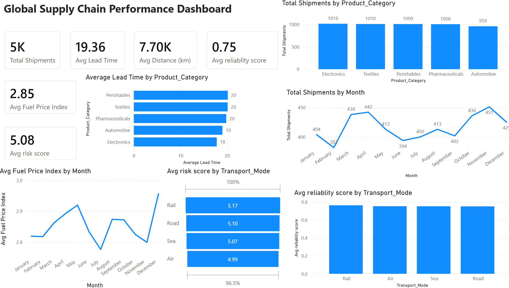
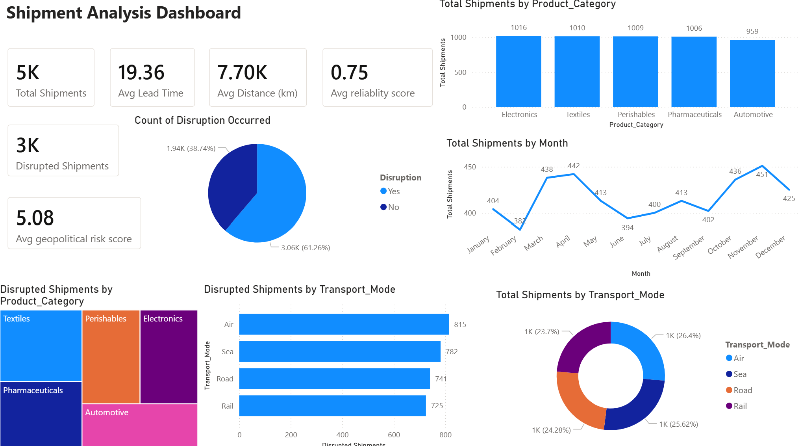
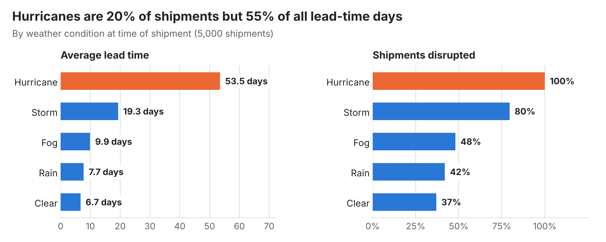
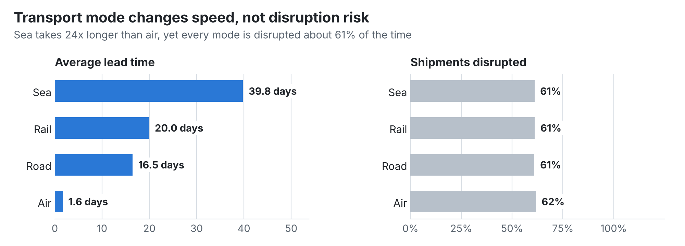
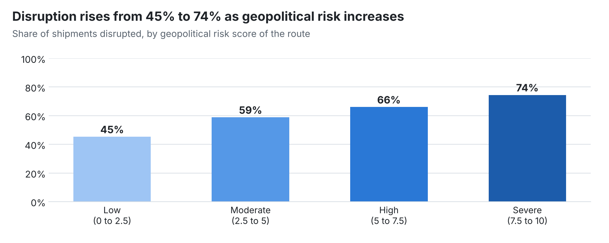
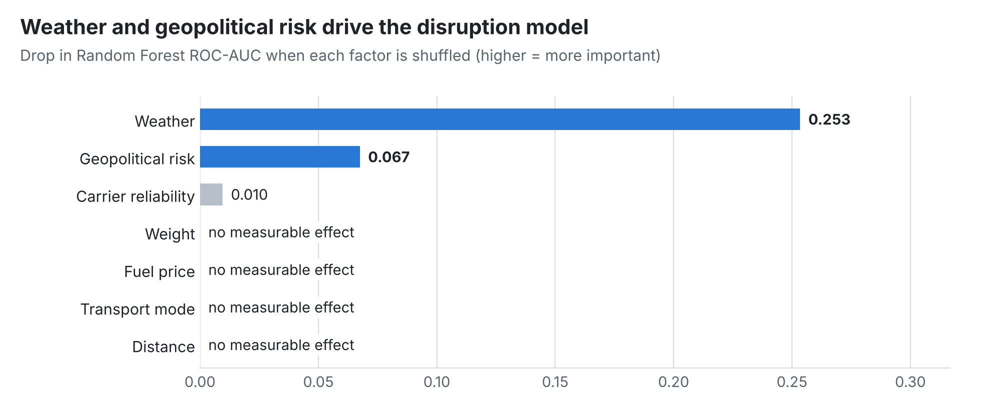

<div align="center">

# 🌍 Global Supply Chain Analytics

### Finding what really drives shipment delays and disruptions, then predicting them


[**Dashboards**](#-power-bi-dashboards) · [**Key insights**](#-key-insights) · [**Prediction model**](#-predicting-disruptions) · [**Recommendations**](#-recommendations) · [**Run it**](#-run-it-yourself)

</div>

---

## 📌 At a glance

| 📦 Shipments analysed | ⏱️ Average lead time | ⚠️ Disrupted | 🎯 Model ROC-AUC |
|:---:|:---:|:---:|:---:|
| **5,000** | **19.4 days** (median 8.2) | **61%** | **0.81** |

5,000 shipments from 2024 to 2025 across 8 major ports (Shanghai, Singapore, Rotterdam, Busan, Hamburg, Antwerp, Dubai, Los Angeles), 4 transport modes and 5 product categories. I used **Python** to explore and model the data and **Power BI** to build interactive dashboards for decision-makers.

**Business questions**
1. Which factors actually drive long lead times and disruptions?
2. Which transport modes, routes and products perform best?
3. Can we predict a disruption before the shipment leaves?

---

## 🎬 Dashboard walkthrough

<!--
  To add a video: record a 30 to 60 second walkthrough of the .pbix in Power BI Desktop
  (on Windows: Win + Alt + R starts and stops recording), then on github.com edit this
  README and drag the .mp4 onto the line below. GitHub replaces it with a playable video.
  Delete this comment afterwards.
-->

https://github.com/user-attachments/assets/REPLACE-WITH-YOUR-VIDEO-LINK

## 📊 Power BI dashboards

**Executive summary:** headline KPIs, shipment volume by month and category, fuel price trend, risk and reliability by transport mode.



**Shipment and disruption analysis:** disruption share, disrupted shipments by product and transport mode, and mode mix.



<sub>Open `global_supply_chain_risk.pbix` in Power BI Desktop to explore the dashboards interactively.</sub>

---

## 💡 Key insights

### 1. Weather is the single biggest driver

<picture>
  <source media="(prefers-color-scheme: dark)" srcset="docs/charts/weather-impact-dark.png">
  
</picture>

- Shipments in hurricanes take **53.5 days** on average, **8x longer** than in clear weather (6.7 days), and **every one of them was disrupted**.
- Hurricanes are only **20% of shipments but 55% of all lead-time days**. That is also why the average lead time (19.4 days) is more than double the median (8.2 days).
- Storms are the second-biggest risk: **80% disrupted** and nearly 3x the clear-weather lead time.

### 2. Transport mode decides speed, not risk

<picture>
  <source media="(prefers-color-scheme: dark)" srcset="docs/charts/transport-mode-dark.png">
  
</picture>

- Sea freight takes **24x longer** than air (39.8 vs 1.6 days), with rail and road in between.
- Yet **every mode is disrupted about 61% of the time**. Switching mode buys speed but does not reduce disruption risk, so mode choice should be driven by cost and urgency, not by risk.

### 3. Geopolitical risk steadily raises disruption

<picture>
  <source media="(prefers-color-scheme: dark)" srcset="docs/charts/geopolitical-risk-dark.png">
  
</picture>

- Disruption climbs from **45% on low-risk routes to 74% on severe-risk routes**, a 29 percentage point increase.
- By contrast, **fuel price, shipment weight and distance showed no meaningful link to disruption**. Distance lengthens lead time but does not make a shipment more likely to be disrupted.

---

## 🤖 Predicting disruptions

I trained two classifiers to flag shipments likely to be disrupted, using distance, weight, fuel price, geopolitical risk, carrier reliability, weather and transport mode. **SMOTE** was applied to the training set only to balance the classes, and models were evaluated on a held-out 20% test set (1,000 shipments).

| Model | Accuracy | Macro F1 | ROC-AUC | Disruptions caught (recall) | Precision when flagged |
|---|:---:|:---:|:---:|:---:|:---:|
| **Random Forest** ✅ | **73%** | **0.72** | **0.81** | 71% | **83%** |
| XGBoost | 70% | 0.69 | 0.79 | 72% | 79% |
| *Baseline: always predict "disrupted"* | *62%* | | | | |

**In plain terms:** the Random Forest catches about 7 in 10 disruptions, and when it flags a shipment it is right more than 8 times in 10.

<picture>
  <source media="(prefers-color-scheme: dark)" srcset="docs/charts/feature-importance-dark.png">
  
</picture>

Permutation importance confirms the exploratory findings: **weather and geopolitical risk carry almost all of the predictive power**, while distance, weight, fuel price and transport mode add nothing measurable.

---

## ✅ Recommendations

1. **Trigger weather-based contingency plans.** With hurricanes and storms behind most delay days, link shipment planning to weather forecasts: reroute, reschedule or add buffer stock when severe weather is forecast on a route.
2. **Score routes for geopolitical risk.** Routes scoring above 7.5 are disrupted 3 times in 4. Add risk premiums, alternative routings or safety stock for these lanes.
3. **Choose transport mode on cost and urgency, not risk.** Disruption rates are the same across modes, so paying for air freight only makes sense when speed matters.
4. **Use the model as an early-warning flag.** At 83% precision, flagged shipments can be reviewed before departure without overwhelming planners with false alarms.

---

## 🛠 Tools and methods

| Area | What I did |
|---|---|
| **Data preparation** (pandas) | Validated 5,000 records (no missing values), engineered a fuel price category (Low / Medium / High), exported a clean dataset for Power BI |
| **Exploratory analysis** (pandas, seaborn, matplotlib) | Lead time by mode, route, product, weather and fuel band; correlation analysis; pair plots |
| **Machine learning** (scikit-learn, imbalanced-learn, XGBoost) | One-hot encoding, 80/20 train/test split, SMOTE on training data only, Random Forest vs XGBoost compared on accuracy, F1 and ROC-AUC |
| **Dashboarding** (Power BI) | KPI cards, monthly trends, mode and category breakdowns, disruption analysis |

---

## 📁 Repository structure

```
├── global_supply_chain_risk.ipynb     # Python analysis and ML models
├── global_supply_chain_risk.pbix      # Power BI dashboards
├── global_supply_chain_risk_2026.csv  # Raw dataset (5,000 shipments)
├── global_shipping_data.csv / .xlsx   # Cleaned data with engineered features (Power BI source)
├── summary.png                        # Dashboard: executive summary
├── shipment_analysis.png              # Dashboard: shipment and disruption analysis
└── docs/
    ├── make_charts.py                 # Rebuilds the README charts and prints all figures
    └── charts/                        # README charts (light and dark versions)
```

## 🚀 Run it yourself

```bash
pip install pandas matplotlib seaborn scikit-learn imbalanced-learn xgboost openpyxl jupyter
jupyter notebook global_supply_chain_risk.ipynb   # full analysis
python docs/make_charts.py                        # rebuild README charts and figures
```

---

## 🔭 Next steps

- Tune the Random Forest (and try calibrated probabilities) to trade recall against precision for different business costs
- Add time-based validation (train on 2024, test on 2025) to check the model holds up over time
- Publish the dashboards to Power BI Service for a shareable live link

<sub>**Dataset note:** _add the dataset source here (for example a Kaggle link)._ Patterns such as every hurricane shipment being disrupted suggest the data may be simulated, so findings illustrate the method rather than describe a real company's network.</sub>
